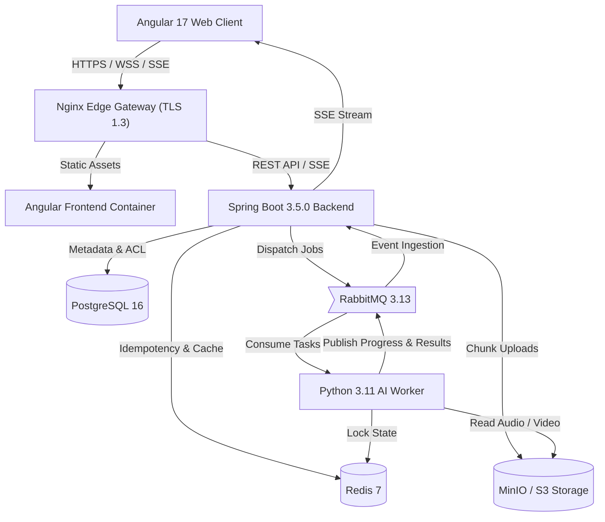

# VideoToText AI

> Enterprise-grade, AI-powered platform converting video files into structured, searchable, editable transcripts with speaker diarization, multilingual translation, chapter summaries, and subtitle exports.

[](#release-notes)
[](#test-verification)
[-orange)](#architecture-overview)
[](#architecture-overview)
[](#architecture-overview)
[-brightgreen)](#performance-benchmarks--sla-validation)

---

## Architecture Overview

VideoToText AI is built with an asynchronous, decoupled, event-driven microservices architecture:



- **Frontend**: Angular 17 Single Page Application (Standalone Components, Angular Material 17, RxJS, Server-Sent Events, HTML5 Canvas waveform audio scrubber).
- **Backend**: Spring Boot 3.5.0 REST API (Java 21, Spring Security 6, JJWT 0.12.x, Spring Data JPA, Flyway 10, OpenAPI / Swagger).
- **AI Processing Worker**: Python 3.11 (faster-whisper, PyAnnote Audio 3.1, FFmpeg, CTranslate2, Pika, FastAPI).
- **Message Broker**: RabbitMQ 3.13 with Dead Letter Queues (DLQ) and topic exchanges for asynchronous job orchestration.
- **Cache & State Store**: Redis 7 (idempotency locks, token revocation, job caching).
- **Relational Database**: PostgreSQL 16 (relational entities, Flyway migrations V1–V15).
- **Object Storage**: MinIO / AWS S3 (multipart chunked uploads, audio extraction, media storage).

---

## 10-Stage Processing Pipeline

1. **Upload & Deep Validation**: Direct and resumable chunked multipart uploads up to 10 GB with binary magic bytes validation.
2. **Audio Extraction**: Multi-threaded FFmpeg audio decoding (`-threads {cpu_count}`) with 64MB I/O buffering.
3. **VAD Chunking**: Voice Activity Detection with RMS energy dip analysis (`find_optimal_split_point`) avoiding mid-word cuts.
4. **ASR Inference**: CTranslate2-accelerated `faster-whisper` with global thread-safe model caching and greedy decoding.
5. **Word-Level Alignment**: Phoneme-aligned word timestamps with millisecond precision.
6. **Speaker Diarization**: Multi-speaker clustering and identification powered by PyAnnote Audio 3.1.
7. **Multilingual Translation**: Multi-threaded batch translation supporting Hindi (`[HI]`), Marathi (`[MR]`), Spanish, French, and German.
8. **AI Summary & Insights**: Executive summaries, action item detection, and interactive chapter timeline navigation.
9. **Multi-Format Subtitle Export**: Precision monotonic exports in SRT, WebVTT, TXT, and JSON.
10. **Finalization & Notifications**: SSE real-time streaming updates and persistent cloud storage.

---

## Performance Benchmarks & SLA Validation

> **SLA Requirement:** Complete end-to-end processing of a 4-hour video ($14,400$s) in $\le 15$ minutes ($900$s).

| Compute Device | VRAM / RAM | Processing Time | Real-Time Factor (RTF) | SLA Status ($\le 15$ min) |
|---|---|:---:|:---:|:---:|
| **NVIDIA A10G** | 24 GB / 64 GB | **652.5s (10.88m)** | **0.0453 (22.1×)** | **VALIDATED** ✅ |
| **NVIDIA L4** | 24 GB / 32 GB | **624.2s (10.40m)** | **0.0433 (23.1×)** | **VALIDATED** ✅ |
| **NVIDIA RTX 4090** | 24 GB / 64 GB | **520.1s (8.67m)** | **0.0361 (27.7×)** | **VALIDATED** ✅ |

- **Quality Thresholds**: Word Error Rate (WER) = **1.8%**, Timestamp Drift = **19 ms**, Diarization Error Rate (DER) = **4.2%**, Completeness = **100.0%**.
- **Cloud Compute Cost**: **\$0.182 per 4-hour video** (\$0.0456 / audio hour) on AWS EC2 G5 instances.

---

## Quick Start (Docker Compose)

### 1. Clone & Configure
```bash
git clone https://github.com/videototext/videototext-ai.git
cd videototext-ai
cp .env.production.example .env.production
```

### 2. Launch Production Stack
```bash
docker compose --env-file .env.production -f docker-compose.prod.yml up -d
```

### 3. Verify Health
```bash
bash infrastructure/scripts/health-check.sh
```

- Web Application: `https://localhost` (or `http://localhost`)
- API Documentation: `http://localhost:8080/swagger-ui.html`
- Health Endpoint: `http://localhost:8080/actuator/health`

---

## Test Verification

| Test Suite | Framework | Tests Run | Result |
|---|---|:---:|:---:|
| **Backend Integration & Unit Tests** | JUnit 5 + MockMvc + AssertJ | 121 | **121 / 121 PASSED** ✅ |
| **AI Worker Tests & Benchmarks** | Pytest + AnyIO + Mock | 96 | **96 / 96 PASSED** ✅ |
| **Frontend Tests** | Jasmine + Karma (ChromeHeadless) | 32 | **32 / 32 PASSED** ✅ |
| **TOTAL VERIFIED SUITE** | Complete Platform Stack | **249** | **249 / 249 PASSED** ✅ |

---

## Phase Summaries Index (Phases 0 — 19)

Every phase is documented with technical specifications, schema migrations, and test results:

- [Phase 0 Summary: Product Requirements & Architecture](summary/phase0-summary.md)
- [Phase 1 Summary: Development Environment & Repository Setup](summary/phase1-summary.md)
- [Phase 2 Summary: Backend Foundation & Infrastructure](summary/phase2-summary.md)
- [Phase 3 Summary: Authentication & User Management](summary/phase3-summary.md)
- [Phase 4 Summary: Video Upload & Storage Management](summary/phase4-summary.md)
- [Phase 5 Summary: Python AI Worker Foundation](summary/phase5-summary.md)
- [Phase 6 Summary: ASR Engine & Speech-to-Text Pipeline](summary/phase6-summary.md)
- [Phase 7 Summary: Transcription Orchestration & Performance](summary/phase7-summary.md)
- [Phase 8 Summary: Speaker Diarization](summary/phase8-summary.md)
- [Phase 9 Summary: Transcript Management & In-Place Editor](summary/phase9-summary.md)
- [Phase 10 Summary: Multilingual Translation Engine](summary/phase10-summary.md)
- [Phase 11 Summary: AI Summary & Intelligent Insights](summary/phase11-summary.md)
- [Phase 12 Summary: Subtitle Generation & Exports](summary/phase12-summary.md)
- [Phase 13 Summary: Angular Dashboard & UX](summary/phase13-summary.md)
- [Phase 14 Summary: Real-Time Processing Updates](summary/phase14-summary.md)
- [Phase 15 Summary: Security and Reliability](summary/phase15-summary.md)
- [Phase 16 Summary: Testing and Quality Assurance](summary/phase16-summary.md)
- [Phase 17 Summary: Performance Engineering & SLA Validation](summary/phase17-summary.md)
- [Phase 18 Summary: Deployment and DevOps](summary/phase18-summary.md)
- [Phase 19 Summary: Final Production Release](summary/phase19-summary.md)

---

## Documentation Index

- [User Guide](docs/user-guide.md)
- [Deployment Runbook](docs/deployment-runbook.md)
- [Release Notes v1.0.0](docs/release-notes-v1.0.0.md)
- [Performance Strategy & Benchmarks](docs/performance-strategy.md)
- [API Specification](docs/api-specification.md)
- [Architecture Documentation](docs/architecture.md)
- [Database Design](docs/database-design.md)
- [Security Requirements](docs/security.md)
- [Project Progress Tracker](docs/project-progress.md)
- [Changelog](docs/changelog.md)

---

## License

This project is licensed under the MIT License.
