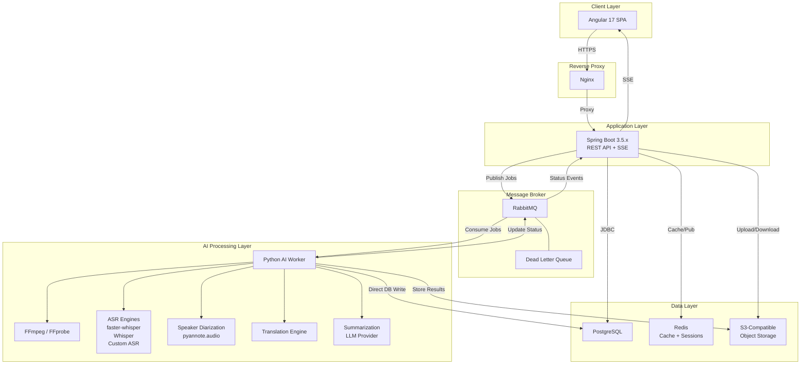
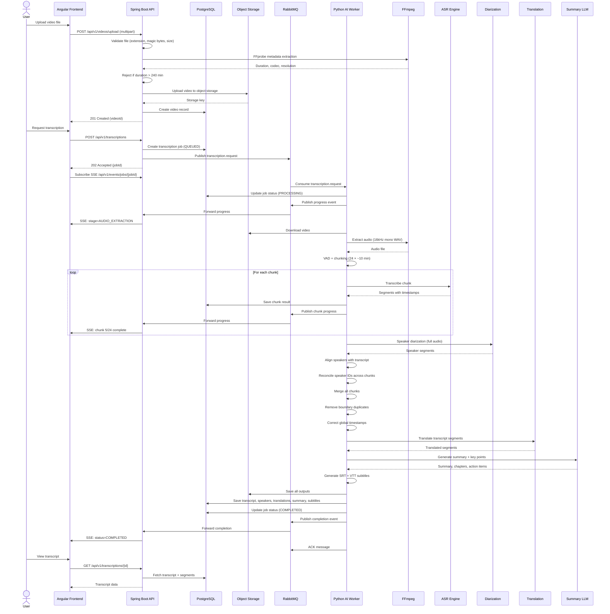
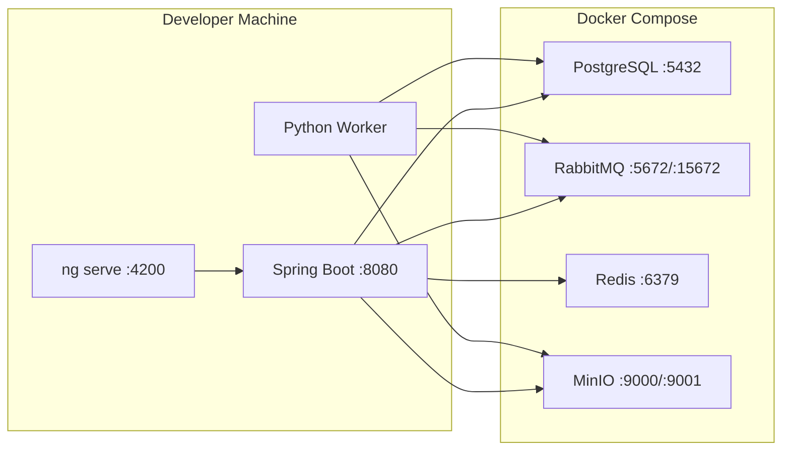
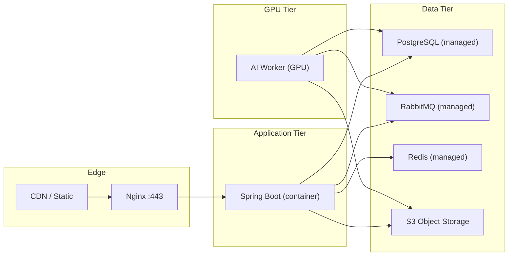

# System Architecture — VideoToText AI

## 1. Architecture Overview

VideoToText AI follows a **modular monolith** backend architecture with an **asynchronous distributed processing** pipeline. The system is composed of three main deployable units:

1. **Angular Frontend** — SPA serving the user interface.
2. **Spring Boot Backend** — API gateway, orchestration, data management, authentication.
3. **Python AI Worker** — GPU-accelerated audio processing, ASR, diarization, translation, summarization.

Communication between the backend and AI worker is fully decoupled via **RabbitMQ**, enabling independent scaling and deployment.

---

## 2. System Architecture Diagram



---

## 3. Component Responsibilities

### 3.1 Angular Frontend

| Responsibility | Details |
|----------------|---------|
| User interface | Login, registration, dashboard, upload, library, editor, exports |
| Authentication | JWT storage, auth interceptor, route guards |
| Upload management | Drag-and-drop, multipart upload, progress tracking |
| Real-time updates | SSE subscription for processing status |
| Transcript editor | View, edit, search, navigate by timestamp |
| Export center | Download SRT, VTT, TXT, JSON |

### 3.2 Spring Boot Backend

| Responsibility | Details |
|----------------|---------|
| Authentication & authorization | JWT issue/validate, refresh tokens, role-based access |
| Video management | Upload validation, metadata extraction, storage orchestration |
| Job orchestration | Create transcription jobs, publish to RabbitMQ, track status |
| Data management | CRUD for all entities via JPA/Hibernate |
| Real-time events | SSE endpoint for processing progress |
| Export generation | Subtitle formatting, file downloads |
| API gateway | OpenAPI docs, rate limiting, validation, error handling |
| Health & monitoring | Actuator endpoints, structured logging |

### 3.3 Python AI Worker

| Responsibility | Details |
|----------------|---------|
| Job consumption | RabbitMQ consumer with ack/nack/retry |
| Audio extraction | FFmpeg video-to-audio conversion |
| Audio preparation | Normalization, VAD, chunking |
| ASR transcription | Provider-based engine selection and execution |
| Speaker diarization | pyannote.audio integration |
| Translation | Transcript segment translation |
| Summarization | LLM-based summary generation |
| Subtitle generation | SRT/VTT formatting |
| Result persistence | Save to PostgreSQL and object storage |
| Status reporting | Publish progress events to RabbitMQ |

### 3.4 Infrastructure Components

| Component | Role |
|-----------|------|
| PostgreSQL | Primary relational database |
| Redis | Caching (user sessions, rate limiting, job status) |
| RabbitMQ | Async message broker between backend and AI worker |
| S3 / MinIO | Object storage for videos, audio, transcripts, exports |
| Nginx | Reverse proxy, TLS termination, static file serving |
| Docker | Containerization for all components |

---

## 4. Video Processing Sequence Diagram



---

## 5. Communication Patterns

### 5.1 Synchronous (REST)

- Frontend ↔ Backend: All user-facing API calls.
- Backend validates, persists, and returns responses.

### 5.2 Asynchronous (RabbitMQ)

**Exchanges and Queues:**

| Exchange | Queue | Routing Key | Purpose |
|----------|-------|-------------|---------|
| `videototext.exchange` | `transcription.requests` | `transcription.request` | New transcription jobs |
| `videototext.exchange` | `transcription.results` | `transcription.result` | Completed job results |
| `videototext.exchange` | `processing.events` | `processing.event` | Progress updates |
| `videototext.dlx` | `transcription.dlq` | `transcription.dead` | Failed messages |

**Message Flow:**
1. Backend publishes job → `transcription.requests` queue.
2. Worker consumes, processes, publishes progress → `processing.events` queue.
3. Backend consumes progress events → pushes via SSE to frontend.
4. Worker publishes completion → `transcription.results` queue.
5. Failed messages (max retries exceeded) → `transcription.dlq`.

### 5.3 Real-Time (SSE)

- Backend → Frontend: Server-Sent Events for live processing updates.
- Per-job SSE stream with automatic reconnection.

---

## 6. Package Structure

### 6.1 Spring Boot Backend

```
com.videototext
├── config/                  # Spring configuration classes
│   ├── SecurityConfig
│   ├── RabbitMQConfig
│   ├── RedisConfig
│   ├── JpaConfig
│   ├── SwaggerConfig
│   └── WebConfig
├── security/                # JWT, filters, auth utilities
│   ├── JwtTokenProvider
│   ├── JwtAuthenticationFilter
│   └── UserDetailsServiceImpl
├── auth/                    # Authentication endpoints
│   ├── AuthController
│   ├── AuthService
│   └── dto/
├── user/                    # User management
│   ├── UserController
│   ├── UserService
│   ├── UserRepository
│   ├── User (entity)
│   └── dto/
├── video/                   # Video upload & management
│   ├── VideoController
│   ├── VideoService
│   ├── VideoRepository
│   ├── Video (entity)
│   ├── validation/
│   └── dto/
├── storage/                 # Object storage abstraction
│   ├── StorageService
│   └── S3StorageService
├── transcription/           # Transcription job management
│   ├── TranscriptionController
│   ├── TranscriptionService
│   ├── TranscriptionJobRepository
│   ├── TranscriptionJob (entity)
│   ├── TranscriptSegment (entity)
│   ├── messaging/
│   └── dto/
├── speaker/                 # Speaker management
│   ├── SpeakerController
│   ├── SpeakerService
│   └── Speaker (entity)
├── translation/             # Translation management
│   ├── TranslationController
│   ├── TranslationService
│   └── Translation (entity)
├── summary/                 # Summary management
│   ├── SummaryController
│   ├── SummaryService
│   └── Summary (entity)
├── subtitle/                # Subtitle generation
│   ├── SubtitleService
│   └── SubtitleGenerator
├── export/                  # Export endpoints
│   ├── ExportController
│   └── ExportService
├── notification/            # SSE event management
│   ├── EventController
│   └── EventService
└── common/                  # Shared utilities
    ├── exception/
    ├── dto/
    └── util/
```

### 6.2 Python AI Worker

```
ai-worker/
├── app/
│   ├── __init__.py
│   ├── main.py                    # Worker entry point
│   ├── config/
│   │   ├── settings.py            # Pydantic settings
│   │   └── logging_config.py
│   ├── consumers/
│   │   └── transcription_consumer.py
│   ├── processors/
│   │   ├── pipeline.py            # Orchestration pipeline
│   │   ├── audio_extractor.py     # FFmpeg wrapper
│   │   ├── audio_normalizer.py
│   │   ├── chunker.py             # Audio chunking
│   │   └── merger.py              # Chunk merge + dedup
│   ├── providers/
│   │   ├── base.py                # ASRProvider interface
│   │   ├── faster_whisper_provider.py
│   │   ├── whisper_provider.py
│   │   └── registry.py            # Provider factory
│   ├── diarization/
│   │   ├── diarizer.py
│   │   └── speaker_reconciler.py
│   ├── translation/
│   │   ├── base.py
│   │   └── translator.py
│   ├── summarization/
│   │   ├── base.py
│   │   └── summarizer.py
│   ├── subtitles/
│   │   ├── srt_generator.py
│   │   └── vtt_generator.py
│   ├── storage/
│   │   └── s3_client.py
│   ├── messaging/
│   │   ├── publisher.py
│   │   └── schemas.py             # Pydantic message models
│   └── models/
│       └── domain.py              # Shared domain models
├── tests/
│   ├── test_pipeline.py
│   ├── test_providers.py
│   ├── test_chunker.py
│   └── test_merger.py
├── requirements.txt
├── Dockerfile
└── README.md
```

### 6.3 Angular Frontend

```
frontend/src/app/
├── core/
│   ├── auth/
│   │   ├── auth.service.ts
│   │   ├── auth.interceptor.ts
│   │   ├── auth.guard.ts
│   │   └── token.service.ts
│   ├── services/
│   │   ├── api.service.ts
│   │   └── notification.service.ts
│   └── models/
│       ├── user.model.ts
│       ├── video.model.ts
│       ├── transcription.model.ts
│       └── api-response.model.ts
├── features/
│   ├── auth/
│   │   ├── login/
│   │   └── register/
│   ├── dashboard/
│   ├── videos/
│   │   ├── upload/
│   │   ├── library/
│   │   └── detail/
│   ├── transcription/
│   │   ├── editor/
│   │   ├── progress/
│   │   └── search/
│   ├── translation/
│   ├── summary/
│   ├── export/
│   └── settings/
├── shared/
│   ├── components/
│   │   ├── header/
│   │   ├── sidebar/
│   │   ├── loading/
│   │   └── error/
│   ├── pipes/
│   └── directives/
└── layouts/
    ├── auth-layout/
    └── main-layout/
```

---

## 7. Deployment Architecture

### 7.1 Local Development



### 7.2 Production



---

## 8. Key Architectural Decisions

See `docs/adr/` for full Architecture Decision Records.

| Decision | Choice | Rationale |
|----------|--------|-----------|
| Backend style | Modular monolith | Simpler deployment; microservices overhead unjustified for v1 |
| Backend-Worker communication | RabbitMQ | Decoupled async processing; reliable delivery; DLQ support |
| ASR engine coupling | Provider abstraction | Swap engines without code changes; benchmark multiple engines |
| Real-time updates | SSE (not WebSocket) | Simpler; unidirectional; sufficient for progress updates |
| Object storage | S3-compatible (MinIO local) | Scalable; production-ready with any S3 provider |
| Database migrations | Flyway | Version-controlled, reproducible schema changes |
| Authentication | JWT (access + refresh) | Stateless; scalable; no server-side session storage |
| Frontend framework | Angular 17 | Strong typing; enterprise patterns; reactive forms |
