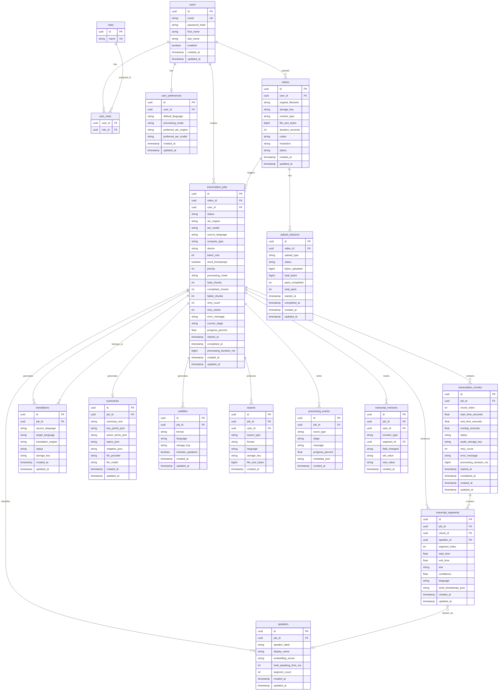

# Database Design — VideoToText AI

## 1. Design Principles

- UUID primary keys for all entities (portability, no sequential exposure).
- `created_at` and `updated_at` timestamps on all tables.
- Proper foreign key constraints with cascading deletes where appropriate.
- Indexes on frequently queried columns (user_id, status, created_at).
- Flyway-managed migrations — never modify an applied migration.
- Soft delete not used — prefer hard delete with audit logging.

---

## 2. Entity Relationship Diagram



---

## 3. Table Details

### 3.1 `users`

Primary user account table.

| Column | Type | Constraints | Notes |
|--------|------|-------------|-------|
| id | UUID | PK, default gen_random_uuid() | |
| email | VARCHAR(255) | UNIQUE, NOT NULL | Login identifier |
| password_hash | VARCHAR(255) | NOT NULL | bcrypt hash |
| first_name | VARCHAR(100) | NOT NULL | |
| last_name | VARCHAR(100) | NOT NULL | |
| enabled | BOOLEAN | NOT NULL, default TRUE | Account active flag |
| created_at | TIMESTAMPTZ | NOT NULL, default NOW() | |
| updated_at | TIMESTAMPTZ | NOT NULL, default NOW() | |

**Indexes**: `idx_users_email` on `email`.

### 3.2 `roles`

Static role definitions.

| Column | Type | Constraints |
|--------|------|-------------|
| id | UUID | PK |
| name | VARCHAR(50) | UNIQUE, NOT NULL |

Seed data: `ROLE_USER`, `ROLE_ADMIN`.

### 3.3 `user_roles`

Join table for many-to-many user–role relationship.

| Column | Type | Constraints |
|--------|------|-------------|
| user_id | UUID | FK → users(id) ON DELETE CASCADE |
| role_id | UUID | FK → roles(id) ON DELETE CASCADE |

**PK**: Composite (user_id, role_id).

### 3.4 `videos`

Uploaded video metadata.

| Column | Type | Constraints | Notes |
|--------|------|-------------|-------|
| id | UUID | PK | |
| user_id | UUID | FK → users(id), NOT NULL | Owner |
| original_filename | VARCHAR(500) | NOT NULL | User's filename |
| storage_key | VARCHAR(1000) | NOT NULL | S3 object key |
| content_type | VARCHAR(100) | NOT NULL | MIME type |
| file_size_bytes | BIGINT | NOT NULL | |
| duration_seconds | INTEGER | NOT NULL | FFprobe duration |
| codec | VARCHAR(50) | | Video codec |
| resolution | VARCHAR(20) | | e.g., "1920x1080" |
| status | VARCHAR(30) | NOT NULL | UPLOADED, PROCESSING, COMPLETED, FAILED, DELETED |
| created_at | TIMESTAMPTZ | NOT NULL | |
| updated_at | TIMESTAMPTZ | NOT NULL | |

**Indexes**: `idx_videos_user_id` on `user_id`, `idx_videos_status` on `status`.

### 3.5 `transcription_jobs`

Central job tracking table.

**Status values**: `QUEUED`, `PROCESSING`, `EXTRACTING_AUDIO`, `TRANSCRIBING`, `DIARIZING`, `TRANSLATING`, `SUMMARIZING`, `GENERATING_SUBTITLES`, `MERGING`, `COMPLETED`, `FAILED`, `CANCELLED`.

**Indexes**: `idx_jobs_user_id`, `idx_jobs_video_id`, `idx_jobs_status`, `idx_jobs_created_at`.

### 3.6 `transcription_chunks`

Individual chunk processing state.

**Status values**: `PENDING`, `PROCESSING`, `COMPLETED`, `FAILED`.

**Indexes**: `idx_chunks_job_id`, `idx_chunks_status`.

### 3.7 `transcript_segments`

The actual transcript content — one row per spoken segment.

**Indexes**: `idx_segments_job_id`, `idx_segments_chunk_id`, `idx_segments_speaker_id`, `idx_segments_start_time`.

**Full-text search**: GIN index on `text` column for full-text search.

### 3.8 `speakers`

Identified speakers per transcription job.

**Indexes**: `idx_speakers_job_id`.

### 3.9 `translations`

Translated transcript versions.

**Status values**: `PENDING`, `PROCESSING`, `COMPLETED`, `FAILED`.

**Indexes**: `idx_translations_job_id`.

### 3.10 `processing_events`

Append-only event log for processing progress tracking and SSE delivery.

**Indexes**: `idx_events_job_id`, `idx_events_created_at`.

**Partitioning consideration**: This table may grow large; consider time-based partitioning or TTL cleanup.

---

## 4. Migration Strategy

All schema changes use Flyway migrations:

```
backend/src/main/resources/db/migration/
├── V1__create_users_and_roles.sql
├── V2__create_user_preferences.sql
├── V3__create_videos.sql
├── V4__create_upload_sessions.sql
├── V5__create_transcription_jobs.sql
├── V6__create_transcription_chunks.sql
├── V7__create_transcript_segments.sql
├── V8__create_speakers.sql
├── V9__create_translations.sql
├── V10__create_summaries.sql
├── V11__create_subtitles.sql
├── V12__create_exports.sql
├── V13__create_processing_events.sql
├── V14__create_transcript_revisions.sql
├── V15__seed_roles.sql
```

**Rules**:
- Never modify an already-applied migration.
- Create a new migration for any schema change.
- Use `TIMESTAMPTZ` for all timestamps (timezone-aware).
- Use `gen_random_uuid()` for UUID defaults (PostgreSQL 13+).

---

## 5. Data Volume Estimates

For a 4-hour video:

| Entity | Estimated Rows | Notes |
|--------|---------------|-------|
| transcript_segments | 5,000 – 15,000 | ~1 segment per 1-3 seconds |
| speakers | 2 – 20 | Typical meeting/interview |
| transcription_chunks | 24 | 10-minute chunks |
| processing_events | 50 – 200 | Per-stage + per-chunk events |
| translations | 1 – 3 | Per target language |

**Storage**: A single 4-hour transcript (text only) is ~50-200 KB. Audio file is ~150-300 MB (16kHz mono WAV). Video file may be 1-10 GB.
